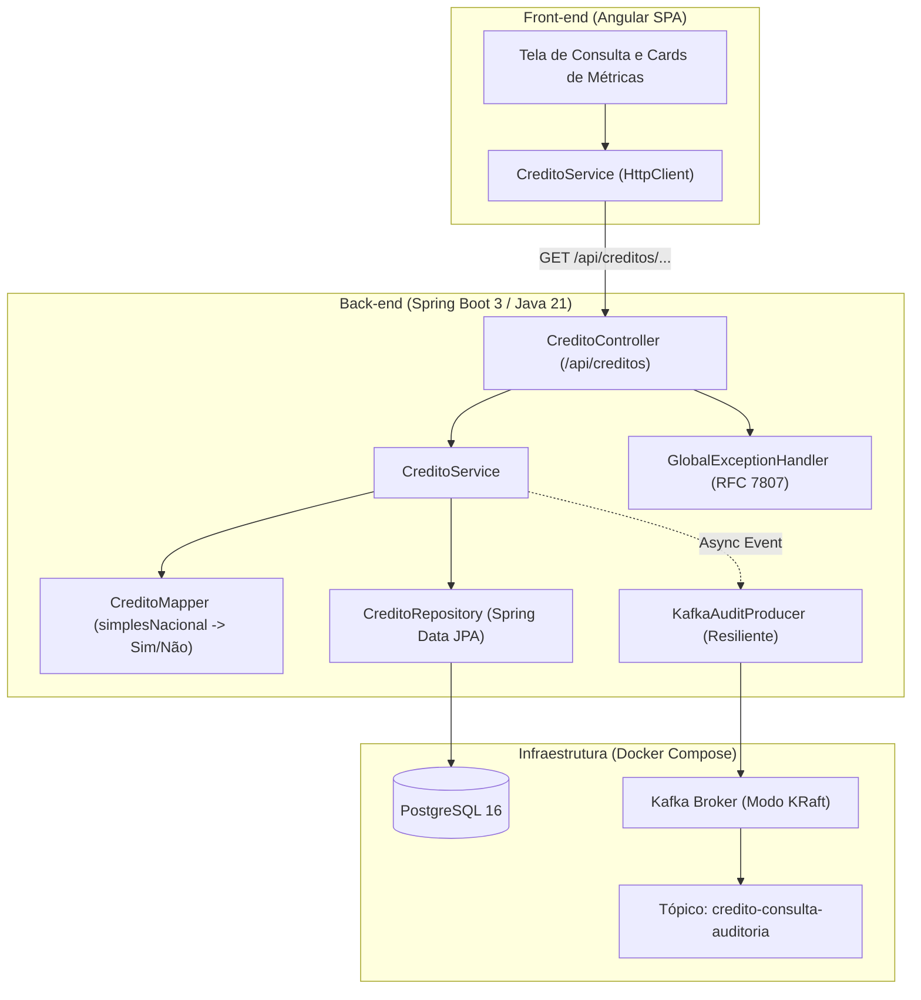

# 🏛️ Sistema de Consulta de Créditos Constituídos

[](https://openjdk.org/)
[](https://spring.io/projects/spring-boot)
[](https://angular.dev/)
[](https://www.postgresql.org/)
[](https://kafka.apache.org/)
[](https://www.docker.com/)
[](LICENSE)

Solução full-stack desenvolvida para o **Desafio Técnico de Desenvolvimento de API de Consulta de Créditos**. O sistema permite consultar créditos constituídos vinculados a uma **NFS-e** ou recuperar o detalhamento integral por **Número do Crédito**, contando com front-end responsivo em Angular, documentação interativa Swagger OpenAPI, containerização completa via Docker Compose e **mensageria assíncrona com Apache Kafka** para auditoria de consultas.

---

## 📌 Sumário
- [Arquitetura da Solução](#-arquitetura-da-solução)
- [Tecnologias Utilizadas](#-tecnologias-utilizadas)
- [Funcionalidades e Diferenciais](#-funcionalidades-e-diferenciais)
- [Executando com Docker Compose (Recomendado)](#-executando-com-docker-compose-recomendado)
- [Executando em Ambiente Local de Desenvolvimento](#-executando-em-ambiente-local-de-desenvolvimento)
- [Endpoints da API RESTful](#-endpoints-da-api-restful)
- [Desafio Adicional: Mensageria e Auditoria (Kafka)](#-desafio-adicional-mensageria-e-auditoria-kafka)
- [Testes Automatizados](#-testes-automatizados)
- [Modelagem de Dados e Carga Inicial](#-modelagem-de-dados-e-carga-inicial)
- [Autor](#-autor)

---

## 🏗️ Arquitetura da Solução



---

## 🚀 Tecnologias Utilizadas

### Back-end
- **Java 21 LTS**
- **Spring Boot 3.3.4**
- **Spring Data JPA & Hibernate**
- **PostgreSQL Driver**
- **Flyway Migration** (versionamento do esquema e carga de dados)
- **Spring Kafka** (produtor assíncrono de eventos)
- **SpringDoc OpenAPI 2.6.0** (Swagger UI e documentação interativa)
- **Lombok** (produtividade e redução de código boilerplate)
- **JUnit 5, Mockito & AssertJ** (testes unitários e de integração)
- **H2 Database** (para testes rápidos em memória)

### Front-end
- **Angular 18+** com **Standalone Components**
- **Angular Signals** (gestão reativa de estado)
- **CSS3 Moderno e Responsivo** (com layout adaptativo para dispositivos móveis)
- **Nginx Alpine** (servidor web e proxy reverso para produção em container)

### Infraestrutura & DevOps
- **Docker & Docker Compose**
- **Apache Kafka 3.8 (Modo KRaft - sem dependência do Zookeeper)**
- **PostgreSQL 16 Alpine** com healthchecks configurados
- **Multi-stage Builds** no Dockerfile para imagens enxutas e seguras (usuário non-root)

---

## ✨ Funcionalidades e Diferenciais

- 🔍 **Consulta Flexível**: Permite alternar instantaneamente entre busca por **NFS-e** (retorna múltiplos créditos) e **Número do Crédito** (retorna o crédito específico).
- ⚡ **Atalhos Rápidos**: Botões com dados de demonstração pré-populados para testes imediatos.
- 📊 **Cards de Métricas**: Apresenta em tempo real o total de créditos, soma do ISSQN, volume faturado e base de cálculo.
- 📱 **Totalmente Responsivo**: Em telas pequenas, a tabela transforma-se automaticamente em cards intuitivos com formatação em Real (R$) e datas brasileiras.
- 🛡️ **Resiliência de Mensageria**: A publicação no Kafka ocorre de forma não bloqueante. Caso o broker esteja offline, a consulta REST continua respondendo normalmente com log de contingência.
- 📜 **Padrão de Resposta Homologado**: O campo `simplesNacional` é mapeado rigorosamente para `"Sim"` / `"Não"`, satisfazendo 100% o contrato do desafio técnico.

---

## 🐳 Executando com Docker Compose (Recomendado)

Com o Docker e Docker Compose instalados, clone o projeto e inicie todos os serviços com um único comando:

```bash
git clone https://github.com/josivantarcio/desafio-consulta-creditos.git
cd desafio-consulta-creditos
docker compose up --build
```

O Docker Compose inicializará:
1. **PostgreSQL** (`creditos_db` na porta `5432`) com migrações Flyway automáticas.
2. **Apache Kafka** (broker KRaft na porta `9092`).
3. **Backend Spring Boot** (porta `8080`).
4. **Frontend Angular** servido pelo Nginx (porta `4200`).

### 🌐 URLs de Acesso

| Serviço | URL | Descrição |
|---|---|---|
| **Frontend Web** | [http://localhost:4200](http://localhost:4200) | Interface gráfica de consulta de créditos |
| **Swagger UI** | [http://localhost:8080/swagger-ui.html](http://localhost:8080/swagger-ui.html) | Documentação interativa e testes da API |
| **OpenAPI Docs** | [http://localhost:8080/v3/api-docs](http://localhost:8080/v3/api-docs) | Especificação OpenAPI 3.0 em JSON |
| **API REST** | [http://localhost:8080/api/creditos](http://localhost:8080/api/creditos) | Endpoints RESTful |

Para parar os serviços:
```bash
docker compose down
```

---

## 💻 Executando em Ambiente Local de Desenvolvimento

Caso deseje rodar a aplicação sem Docker Compose:

### Pré-requisitos
- **Java 21**
- **Node.js 20+** e **npm**
- **PostgreSQL** ativo localmente (ou via Docker: `docker run -d -p 5432:5432 -e POSTGRES_DB=creditos_db -e POSTGRES_USER=credito_user -e POSTGRES_PASSWORD=credito_pass postgres:16-alpine`)

### 1. Iniciar o Back-end
```bash
cd backend
./mvnw spring-boot:run
```
O backend iniciará na porta `8080`.

### 2. Iniciar o Front-end
```bash
cd frontend
npm install
npm start
```
O Angular estará disponível em `http://localhost:4200`.

---

## 📡 Endpoints da API RESTful

### 1. Consultar Créditos por Número da NFS-e
Retorna a lista de créditos constituídos vinculados a uma determinada nota fiscal de serviços.

- **Método**: `GET`
- **Rota**: `/api/creditos/{numeroNfse}`
- **Exemplo de Chamada**:
```bash
curl -X GET "http://localhost:8080/api/creditos/7891011" -H "accept: application/json"
```

- **Exemplo de Resposta (200 OK)**:
```json
[
  {
    "numeroCredito": "123456",
    "numeroNfse": "7891011",
    "dataConstituicao": "2024-02-25",
    "valorIssqn": 1500.75,
    "tipoCredito": "ISSQN",
    "simplesNacional": "Sim",
    "aliquota": 5.0,
    "valorFaturado": 30000.00,
    "valorDeducao": 5000.00,
    "baseCalculo": 25000.00
  },
  {
    "numeroCredito": "789012",
    "numeroNfse": "7891011",
    "dataConstituicao": "2024-02-26",
    "valorIssqn": 1200.50,
    "tipoCredito": "ISSQN",
    "simplesNacional": "Não",
    "aliquota": 4.5,
    "valorFaturado": 25000.00,
    "valorDeducao": 4000.00,
    "baseCalculo": 21000.00
  }
]
```

---

### 2. Consultar Crédito Específico por Número do Crédito
Retorna os atributos completos de um único crédito constituído.

- **Método**: `GET`
- **Rota**: `/api/creditos/credito/{numeroCredito}`
- **Exemplo de Chamada**:
```bash
curl -X GET "http://localhost:8080/api/creditos/credito/123456" -H "accept: application/json"
```

- **Exemplo de Resposta (200 OK)**:
```json
{
  "numeroCredito": "123456",
  "numeroNfse": "7891011",
  "dataConstituicao": "2024-02-25",
  "valorIssqn": 1500.75,
  "tipoCredito": "ISSQN",
  "simplesNacional": "Sim",
  "aliquota": 5.0,
  "valorFaturado": 30000.00,
  "valorDeducao": 5000.00,
  "baseCalculo": 25000.00
}
```

- **Exemplo de Resposta quando não encontrado (404 Not Found)**:
```json
{
  "status": 404,
  "error": "Not Found",
  "message": "Crédito constituído com o número '999999' não foi encontrado.",
  "path": "/api/creditos/credito/999999",
  "timestamp": "2026-09-27T18:30:00"
}
```

---

## 📨 Desafio Adicional: Mensageria e Auditoria (Kafka)

Conforme proposto no item de desafios extras do documento técnico, a aplicação conta com um produtor Kafka assíncrono que notifica o tópico `credito-consulta-auditoria` sempre que uma consulta é realizada.

### Modelo do Evento (`CreditoConsultaEvent`)
```json
{
  "eventId": "e9b25fb4-c6a1-4fc3-a26c-d278453ea44b",
  "tipoConsulta": "NFSE",
  "parametroConsulta": "7891011",
  "quantidadeResultados": 2,
  "status": "SUCESSO",
  "timestamp": "2026-09-27T18:39:44.104"
}
```

### Visualizando os Eventos no Kafka via Docker
Para inspecionar os eventos sendo publicados em tempo real no tópico de auditoria:
```bash
docker exec -it credito-kafka /opt/kafka/bin/kafka-console-consumer.sh \
  --bootstrap-server localhost:9092 \
  --topic credito-consulta-auditoria \
  --from-beginning
```

---

## 🧪 Testes Automatizados

O projeto conta com suíte abrangente de testes unitários e de integração cobrindo regras de negócio, conversão de dados, tratamento de erros HTTP e persistência.

### Executar os Testes do Backend
```bash
cd backend
./mvnw clean test
```

### Cobertura de Testes
- **`CreditoServiceTest`**: Testes unitários com Mockito validando chamadas aos repositórios, disparos para o KafkaAuditProducer e lançamento de exceções para créditos inexistentes.
- **`CreditoMapperTest`**: Validação da formatação de optante Simples Nacional (`boolean` -> `"Sim"` / `"Não"`) e integridade dos valores decimais.
- **`CreditoControllerTest`**: Testes de camada web com `MockMvc` validando status HTTP 200, 404 e estrutura JSON.
- **`CreditoIntegrationTest`**: Teste de ponta a ponta com banco H2 em memória validando a persistência e o retorno das rotas REST.

---

## 🗄️ Modelagem de Dados e Carga Inicial

A criação da tabela e os dados iniciais são gerenciados via **Flyway Migrations** em `backend/src/main/resources/db/migration/`:

- `V1__create_table_credito.sql`: Cria a tabela `credito` com os tipos e índices otimizados.
- `V2__seed_credito.sql`: Popula a tabela com os 3 registros solicitados no desafio:
  - NFS-e `7891011` -> Créditos `123456` (Simples: Sim) e `789012` (Simples: Não).
  - NFS-e `1122334` -> Crédito `654321` (Simples: Sim).

---

## 👤 Autor

Desenvolvido por **Josevan Oliveira**
- **GitHub**: [@josivantarcio](https://github.com/josivantarcio)
- **E-mail**: [josivantarcio@gmail.com](mailto:josivantarcio@gmail.com)

---

## 📄 Licença

Este projeto está licenciado sob os termos da licença [MIT](LICENSE).
